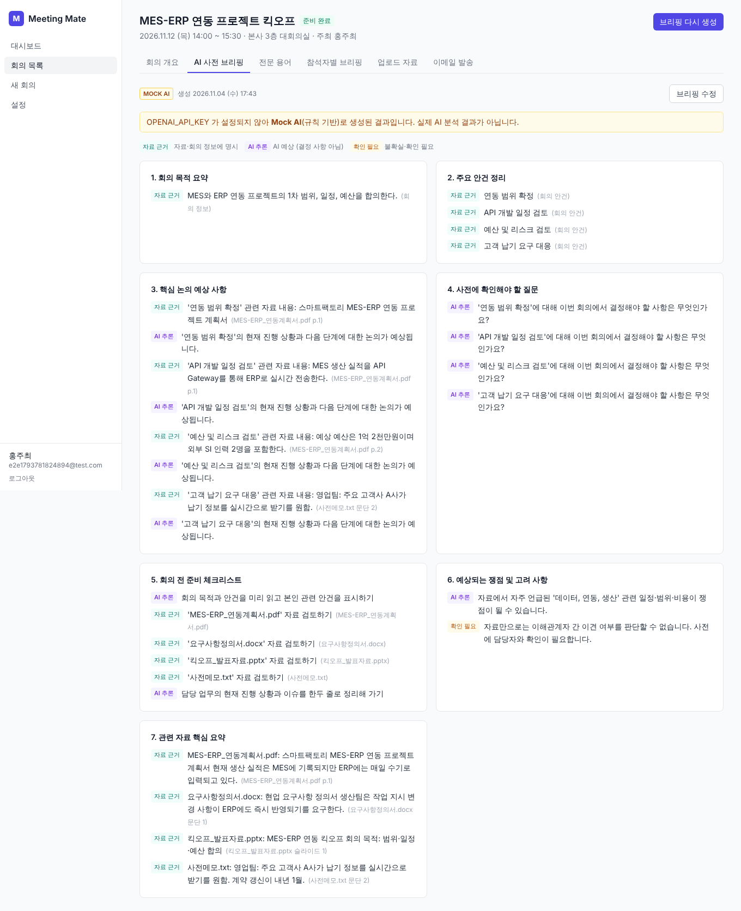
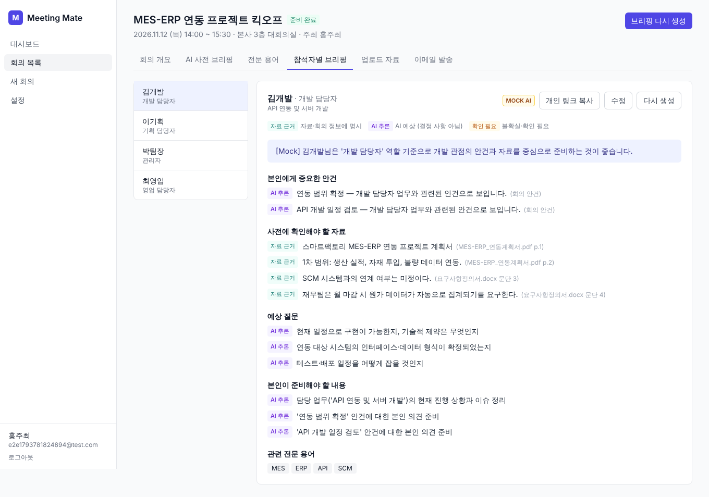
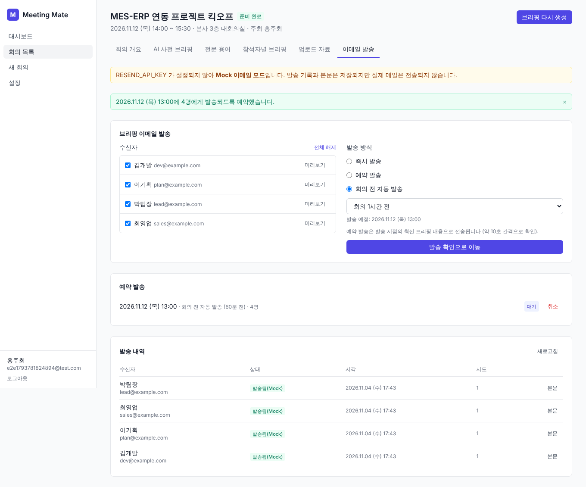
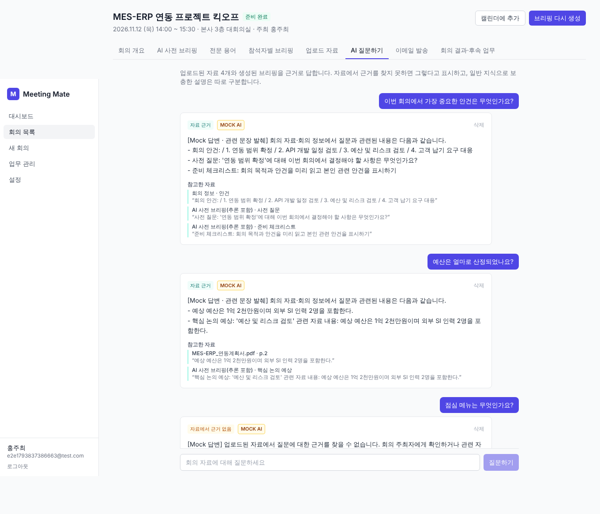
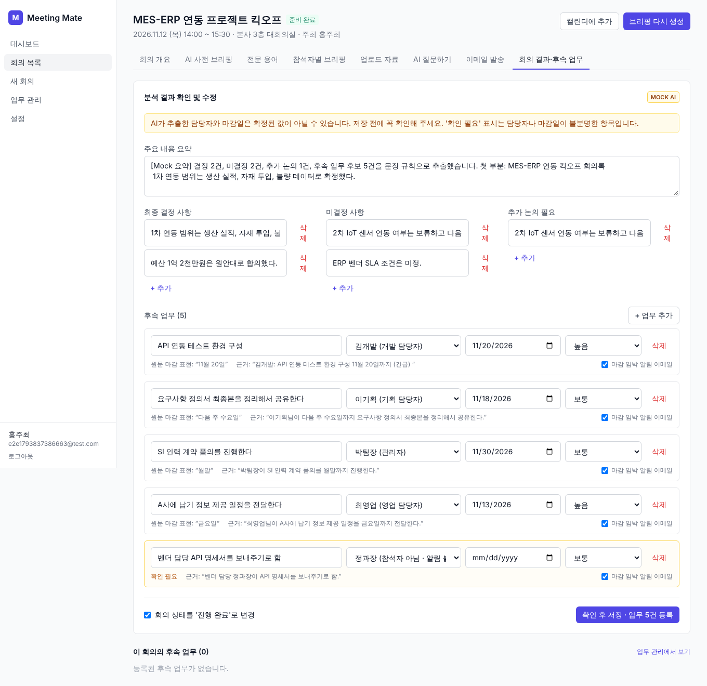
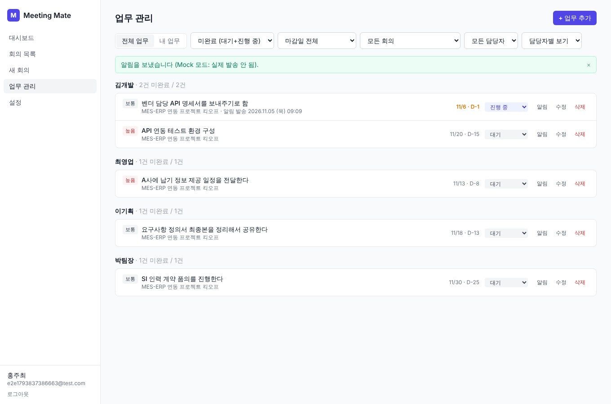

# Meeting Mate

일반 사무직 직장인을 위한 **AI 회의 사전 준비 · 후속 업무 자동화 플랫폼**.
회의록을 대신 써 주는 서비스가 아니라, 회의 **전에** 참석자 각자가 무엇을 준비해야 하는지 알려 주는 데 초점을 둡니다.

**회의 등록 → 자료 분석 → AI 브리핑(공통 · 전문 용어 · 참석자별) → 이메일 발송 → AI 질의응답 → 회의 결과 입력 → 후속 업무 자동 추출 → 업무 관리·마감 알림**까지 하나의 흐름으로 동작합니다.

| AI 사전 브리핑 | 참석자별 브리핑 | 이메일 발송 |
|---|---|---|
|  |  |  |

| AI 질문하기 | 회의 결과 → 업무 추출 | 업무 관리 |
|---|---|---|
|  |  |  |

## 구현 범위

| 기능 | 상태 |
|---|---|
| ① 회의 생성·관리 (정보, 참석자·역할, 상태 예정/준비 완료/진행 완료) | ✅ 구현 |
| ② 자료 업로드·분석 (PDF/DOCX/PPTX/TXT, 위치별 텍스트 추출, 제목·요약·키워드) | ✅ 구현 |
| ③ AI 사전 브리핑 7개 섹션, 사실/추론/불확실 구분, 웹에서 수정 | ✅ 구현 |
| ④ 전문 용어 추출 (쉬운 설명·실무 의미·관련 개념·자료 문맥·출처), 수정 | ✅ 구현 |
| ⑤ 참석자별 맞춤 브리핑 (역할·담당 업무 기반), 개별 재생성·수정, 로그인 없는 개인 링크 | ✅ 구현 |
| ⑥ 이메일 발송 (미리보기 → 확인 → 즉시/예약/회의 N분 전, 기록, 실패 재시도, 예약 취소, 중복 방지) | ✅ 구현 |
| ⑦ 자료 기반 AI 질의응답 (자료·회의 정보·브리핑 검색, 파일명+위치 출처, 근거 없음 표시, 일반 지식 분리) | ✅ 구현 |
| ⑧ 회의 결과 분석 (텍스트 입력/회의록 파일 → 요약·결정·미결정·추가 논의·담당자별 업무·마감일·우선순위), 확인·수정 후 확정 | ✅ 구현 |
| ⑨ 업무 관리 (전체/내 업무, 담당자별·회의별, 상태·우선순위·마감 필터), 마감 임박 자동 알림, 수동 알림, 재시도 | ✅ 구현 |
| ⑩ 캘린더 | ✅ `.ics` 내보내기 (Google Calendar·Outlook 가져오기) / ⏳ Google Calendar API 직접 연동은 확장 지점(인터페이스, `external_calendar_id`)만 준비 |
| 실제 배포 | ⏳ 설정 파일(render.yaml, vercel.json)만 준비 |
| 음성 파일 자동 전사 | ✕ 요구사항대로 초기 버전 범위 밖 |

## Mock 모드와 실제 API 구분

API 키 없이도 전체 흐름을 테스트할 수 있습니다.

| | 키 없음 (기본) | 키 설정 시 |
|---|---|---|
| AI (`OPENAI_API_KEY`) | **Mock AI**: 회의 정보·자료 텍스트를 규칙 기반으로 가공 (내장 용어 사전 약 30개, 모르는 약어는 '확인 필요'로 표시 / 질의응답은 관련 문장 발췌 / 회의 결과는 문장 패턴·날짜 표현 규칙으로 추출) | OpenAI Chat Completions (JSON 모드) |
| 이메일 (`RESEND_API_KEY`) | **Mock**: 실제 발송 없음, 본문과 기록만 저장 | Resend API로 실제 발송 |

Mock 결과는 DB에 `source="mock"` / `provider="mock"`으로 저장되며, 화면의 `MOCK AI` 배지, 이메일 제목의 `[MOCK]` 표시와 안내 배너, 발송 내역의 `발송됨(Mock)` 표시로 실제 결과와 구분됩니다. 현재 연결 상태는 **설정 → 이메일·API 연동 상태**에서 확인할 수 있습니다.

## 기술 스택

- **Frontend**: React 18, Vite 5, TypeScript, Tailwind CSS 3, React Router 6, Axios
- **Backend**: Python 3.12+, FastAPI, SQLAlchemy 2, Pydantic 2, APScheduler
- **DB**: PostgreSQL 14+
- **파일 처리**: PyMuPDF, python-docx, python-pptx
- **외부 API**: OpenAI, Resend

설계 문서(프로젝트 구조, DB 관계, 전체 API 목록, 설계 결정): [docs/ARCHITECTURE.md](docs/ARCHITECTURE.md)

## 로컬 실행

### 1) PostgreSQL 준비

```bash
createuser -P meetingmate        # 비밀번호: meetingmate (예시)
```

```bash
createdb -O meetingmate meetingmate
```

```bash
createdb -O meetingmate meetingmate_test   # 테스트용
```

Docker를 쓴다면:

```bash
docker run -d --name mm-pg -p 5432:5432 -e POSTGRES_USER=meetingmate -e POSTGRES_PASSWORD=meetingmate -e POSTGRES_DB=meetingmate postgres:16
```

### 2) 백엔드

```bash
cd backend
python3 -m venv .venv && source .venv/bin/activate
pip install -r requirements.txt
cp .env.example .env      # 값 채우기 (아래 환경변수 표 참고)
uvicorn app.main:app --reload --port 8000
```

테이블은 서버 시작 시 자동 생성됩니다. API 문서: http://localhost:8000/docs

### 3) 프론트엔드

```bash
cd frontend
npm install
cp .env.example .env      # VITE_API_URL=http://localhost:8000
npm run dev               # http://localhost:5173
```

### 4) 시연용 샘플 자료

`samples/` 폴더에 PDF·DOCX·PPTX·TXT 회의 자료 샘플과 회의 결과 분석용 `회의록_킥오프.txt`가 들어 있습니다. 다시 만들려면 `cd backend && python scripts/make_samples.py`를 실행하세요.

## 환경변수 (backend/.env)

| 변수 | 필수 | 설명 |
|---|---|---|
| `DATABASE_URL` | ✅ | `postgresql+psycopg://user:pw@host:5432/db` (`postgres://` 형식도 자동 변환) |
| `JWT_SECRET` | 운영 ✅ | 토큰 서명 키. 개발에서 비우면 재시작할 때마다 임의 생성 |
| `APP_ENV` | | `production`이면 `JWT_SECRET`이 없을 때 시작을 거부 |
| `ADMIN_EMAILS` | | 가입 시 관리자 권한을 부여할 이메일 (콤마 구분) |
| `OPENAI_API_KEY` | | 없으면 Mock AI |
| `OPENAI_MODEL` | | 기본 `gpt-4o-mini` |
| `AI_PROVIDER` | | `auto`(기본) / `openai` / `mock` |
| `RESEND_API_KEY` | | 없으면 Mock 이메일 |
| `EMAIL_FROM` | | Resend에서 인증한 도메인 주소. 테스트용 `onboarding@resend.dev`는 본인 계정 이메일로만 발송 가능 |
| `EMAIL_PROVIDER` | | `auto`(기본) / `resend` / `mock` |
| `FRONTEND_URL` | ✅ | 이메일 속 개인 브리핑 링크의 기준 URL |
| `CORS_ORIGINS` | ✅ | 프론트엔드 주소 (콤마 구분) |
| `DISPLAY_TIMEZONE` | | 이메일 속 일시 표시 시간대 (기본 `Asia/Seoul`) |
| `UPLOAD_DIR` / `MAX_UPLOAD_MB` | | 업로드 경로 / 파일당 용량 제한 (기본 20MB) |
| `SCHEDULER_ENABLED` / `SCHEDULER_INTERVAL_SECONDS` | | 예약 발송·마감 알림 스케줄러 사용 여부 / 확인 주기 (기본 30초) |
| `TASK_REMINDER_DAYS_BEFORE` | | 후속 업무 마감 며칠 전부터 알림을 보낼지 (기본 1, 업무당 1회) |

프론트엔드: `VITE_API_URL` (백엔드 주소)

API 키는 코드나 화면에 입력하지 않고 서버 환경변수로만 관리합니다. `.env`는 `.gitignore`에 포함되어 있습니다.

## 사용 흐름

1. 회원가입 / 로그인
2. **새 회의**: 정보, 안건(한 줄에 하나), 참석자(이름·이메일·역할·담당 업무), 자료 업로드 → `회의 등록 및 브리핑 생성`
3. 회의 상세의 탭
   - **AI 사전 브리핑**: 7개 섹션. 각 항목에 `자료 근거` / `AI 추론` / `확인 필요` 배지와 출처(파일명 + 페이지·슬라이드·문단)가 붙습니다. `브리핑 수정`으로 편집할 수 있습니다.
   - **전문 용어**: 회의 맥락에 맞춘 설명, 자료 속 문장 인용, 수정·삭제
   - **참석자별 브리핑**: 역할별로 다른 중요 안건·확인할 자료·예상 질문·준비 사항. 수정, 다시 생성, `개인 링크 복사`
   - **업로드 자료**: 추출 텍스트(위치별), 요약, 키워드, 재분석
   - **이메일 발송**: 수신자 선택 → 미리보기 → 발송 방식(즉시 / 예약 / 회의 N분 전) → 확인 모달에서 동의 체크 → 발송. 내역에서 본문 확인, 실패 건 재시도, 예약 취소
   - **AI 질문하기**: 자료·회의 정보·브리핑을 근거로 답변. 배지로 `자료 근거` / `자료 + 일반 지식` / `자료에서 근거 없음`을 구분하고, 참고한 파일명·위치와 인용문을 보여 줍니다. 일반 지식 설명은 별도 상자로 분리됩니다. 참석자도 질문할 수 있고, 질문 기록은 본인 것만 보입니다.
   - **회의 결과·후속 업무**: 회의 내용을 붙여 넣거나 회의록 파일을 올려 `AI로 결과 분석` → 요약·결정·미결정·추가 논의와 업무 후보(담당자·마감일·우선순위)를 확인·수정 → `확인 후 저장`을 누르면 업무가 등록되고 회의가 '진행 완료'가 됩니다. '다음 주 금요일' 같은 표현은 회의일 기준 날짜로 바뀌고, 담당자·마감일이 불분명하면 '확인 필요'로 표시됩니다.
   - 상단 `캘린더에 추가`: `.ics` 파일을 내려받아 Google Calendar·Outlook에 가져올 수 있습니다.
4. **업무 관리**(`/tasks`): 전체/내 업무, 상태·마감 임박·기한 지남·회의·담당자 필터, 담당자별·회의별 보기. 진행 상태(대기/진행 중/완료)는 회의 생성자와 담당자 본인이 바꿀 수 있고, 수정·삭제·`알림` 발송은 회의 생성자만 할 수 있습니다.
5. **마감 알림**: 알림이 켜진 미완료 업무는 마감 `TASK_REMINDER_DAYS_BEFORE`일 전부터 담당자에게 이메일이 **한 번** 자동 발송됩니다. 담당자가 설정에서 이메일 알림을 끄면 보내지 않습니다. 실패한 알림은 회의의 이메일 발송 내역에서 재시도할 수 있습니다.
6. 참석자는 이메일 링크(`/b/{token}`)로 로그인 없이 개인 브리핑과 체크리스트를 봅니다. 같은 이메일로 가입하면 회의를 열람·질문할 수 있고, 본인 브리핑과 본인 업무만 다룰 수 있습니다.

## API 사용 예시

```bash
TOKEN=$(curl -s localhost:8000/api/auth/login -H 'content-type: application/json' -d '{"email":"me@example.com","password":"password123"}' | python3 -c 'import sys,json;print(json.load(sys.stdin)["access_token"])')
```

```bash
curl -s localhost:8000/api/meetings -H "Authorization: Bearer $TOKEN" -H 'content-type: application/json' -d '{"title":"킥오프","purpose":"범위 합의","start_at":"2026-11-20T14:00:00+09:00","agenda":"범위\n일정","participants":[{"name":"김개발","email":"dev@example.com","role":"개발 담당자","responsibility":"API 연동"}]}'
```

```bash
curl -s localhost:8000/api/meetings/1/materials -H "Authorization: Bearer $TOKEN" -F "files=@samples/MES-ERP_연동계획서.pdf"
```

```bash
curl -s -X POST localhost:8000/api/meetings/1/briefings/generate -H "Authorization: Bearer $TOKEN"
```

```bash
curl -s localhost:8000/api/meetings/1/emails/send -H "Authorization: Bearer $TOKEN" -H 'content-type: application/json' -d '{"participant_ids":[1],"mode":"before_meeting","minutes_before":60,"confirm":true}'
```

```bash
curl -s localhost:8000/api/meetings/1/questions -H "Authorization: Bearer $TOKEN" -H 'content-type: application/json' -d '{"question":"예산은 얼마로 산정되었나요?"}'
```

```bash
curl -s localhost:8000/api/meetings/1/result/analyze -H "Authorization: Bearer $TOKEN" -F "file=@samples/회의록_킥오프.txt"
```

```bash
curl -s localhost:8000/api/meetings/1/result/confirm -H "Authorization: Bearer $TOKEN" -H 'content-type: application/json' -d '{"summary":"범위 확정","decisions":["1차 범위 확정"],"tasks":[{"title":"API 연동 테스트","assignee_participant_id":1,"due_date":"2026-11-20","priority":"high"}]}'
```

```bash
curl -s "localhost:8000/api/tasks?scope=mine&status=open" -H "Authorization: Bearer $TOKEN"
```

전체 목록: [docs/ARCHITECTURE.md#3-api-목록-구현-완료](docs/ARCHITECTURE.md), 또는 `/docs` (Swagger UI)

## 테스트

백엔드 통합 테스트는 실제 PostgreSQL(`meetingmate_test` DB)에서 실행됩니다. 44개 테스트가 인증, 권한, 회의·참석자 CRUD, 파일 4종 추출, 파일 검증, 브리핑 생성·수정, AI 실패 시 기존 결과 보존, OpenAI 응답 파싱·검증, 이메일 미리보기·확인·즉시·예약·회의 전 발송, 실패 재시도, 동시 선점(중복 방지), 질의응답 출처·근거 없음·지어낸 출처 제거, 회의 결과 초안/확정·담당자 매칭·마감 표현 해석, 업무 권한·필터, 마감 알림 1회 발송·알림 설정 반영·재시도, .ics를 검증합니다.

```bash
cd backend && source .venv/bin/activate
pytest -q   # 기본 대상: meetingmate_test (TEST_DATABASE_URL로 변경, 이름이 _test로 끝나야 실행됨)
```

브라우저 E2E (백엔드·프론트를 띄운 상태에서, Playwright 필요):

```bash
node e2e/flow.js
```

프론트 타입 검사 / 빌드:

```bash
cd frontend && npm run build
```

## 배포

### 백엔드 + DB: Render

1. GitHub에 push한 뒤 Render에서 **New → Blueprint**를 선택하고 저장소를 연결합니다. `render.yaml`이 웹 서비스와 PostgreSQL을 함께 만듭니다.
2. 대시보드에서 `OPENAI_API_KEY`, `RESEND_API_KEY`, `EMAIL_FROM`, `FRONTEND_URL`, `CORS_ORIGINS`(= 프론트 URL), `ADMIN_EMAILS`를 입력합니다.
3. 헬스체크: `https://<api>.onrender.com/api/health`

Railway를 쓸 경우: Root Directory를 `backend`로, Start Command를 `uvicorn app.main:app --host 0.0.0.0 --port $PORT --workers 1`로 지정하고 PostgreSQL 플러그인의 `DATABASE_URL`을 연결합니다.

### 프론트엔드: Vercel

Root Directory를 `frontend`로, Framework를 Vite로 지정하고 환경변수 `VITE_API_URL=https://<api>.onrender.com`을 설정합니다. SPA 라우팅용 `vercel.json`이 포함되어 있습니다.

### 운영 시 주의 사항

- Render 무료 플랜은 디스크가 휘발성입니다. 업로드 원본 파일은 재배포 시 사라질 수 있지만 **추출 텍스트·분석 결과는 DB에 저장**되므로 브리핑에는 영향이 없습니다(재분석만 불가). 원본을 보존하려면 Persistent Disk나 S3를 연결하세요.
- 무료 플랜은 유휴 시 서버가 잠들어 예약 발송이 늦어질 수 있습니다. 예약 발송을 정시에 보내려면 상시 실행 플랜을 사용하세요.
- 스키마 변경은 현재 `create_all`(새 테이블만 생성)에 의존합니다. 운영 중 컬럼 변경이 필요해지면 Alembic을 도입해야 합니다.
